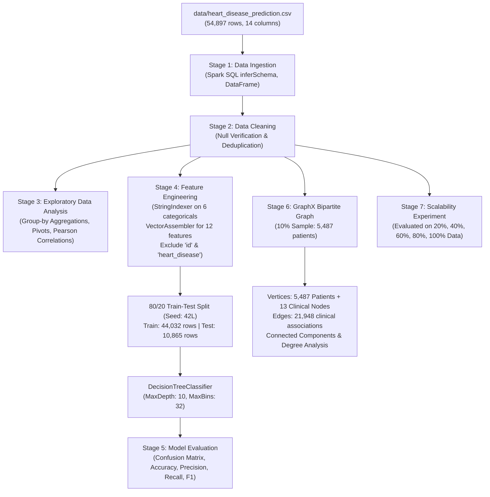

# Heart Disease Prediction and Healthcare Analytics

An academic big-data healthcare analytics project built with **Scala 2.12**, **Apache Spark 3.5.8**, **Spark SQL**, **Spark MLlib**, and **Spark GraphX** to predict heart disease risk and analyze patient clinical attribute networks.

---

## 1. System Architecture



---

## 2. Dataset Overview

The dataset is located at `data/heart_disease_prediction.csv` and contains **54,897 records** and **14 columns**.

| Metric / Property | Inspected Real Value |
|-------------------|----------------------|
| **Total Rows** | 54,897 records |
| **Total Features** | 13 input features + 1 target (`heart_disease`) |
| **Missing / Null Values** | **0** across all 14 columns |
| **Duplicate IDs** | **0** (Unique identifiers 1 to 54,897) |
| **Class Distribution** | `heart_disease = 1`: **43,286 (78.85%)**<br>`heart_disease = 0`: **11,611 (21.15%)** (Class Imbalance) |
| **Age Range** | 18 to 90 years (Mean: 53.99, StdDev: 21.10) |

### Column Schema & Clinical Roles

| Column Name | Data Type | Role | Clinical Significance |
|---|---|---|---|
| `id` | Integer | Identifier | Patient record ID (**Excluded from model** to avoid artificial leakage) |
| `age` | Integer | Numerical Feature | Patient age in years |
| `gender` | String | Categorical Feature | Male (27,451) / Female (27,446) |
| `chest_pain_type` | String | Categorical Feature | Asymptomatic, Atypical Angina, Typical Angina, Non-Anginal Pain |
| `resting_bp` | Integer | Numerical Feature | Resting blood pressure (mm Hg, range: 80 - 200) |
| `cholesterol` | Integer | Numerical Feature | Serum cholesterol (mg/dl, range: 100 - 600) |
| `fasting_blood_sugar`| Integer | Binary (0 / 1) | Fasting blood sugar > 120 mg/dl (1 = true, 0 = false) |
| `resting_ecg` | String | Categorical Feature | Normal, ST-T Wave Abnormality, Left Ventricular Hypertrophy |
| `max_heart_rate` | Integer | Numerical Feature | Maximum heart rate achieved (range: 60 - 202) |
| `exercise_angina` | String | Categorical Feature | Exercise-induced angina (Yes / No) |
| `oldpeak` | Double | Numerical Feature | ST depression induced by exercise relative to rest (0.0 - 6.5) |
| `slope` | String | Categorical Feature | Slope of peak exercise ST segment (Upsloping, Flat, Downsloping) |
| `thal` | String | Categorical Feature | Thallium stress test result (Normal, Fixed Defect, Reversible Defect) |
| `heart_disease` | Integer | **Target Label** | 1 = Disease detected, 0 = No disease detected |

---

## 3. Technology Stack & Versions

- **Programming Language**: Scala 2.12.20
- **Compute Engine**: Apache Spark 3.5.8 (`spark-core`, `spark-sql`, `spark-mllib`, `spark-graphx`)
- **Java Runtime**: JDK 1.8.0_202 (Java 8)
- **Build & Dependency Tool**: sbt 1.10.11 (Bundled in local `sbt/` directory)
- **Operating System**: Windows 10 (x64)

---

## 4. Actual Verified Experimental Results

*(Results obtained from end-to-end execution on the actual 54,897 dataset rows)*

### Stage 3: Exploratory Data Analysis (EDA) Insights

1. **Target Correlation**:
   - `fasting_blood_sugar`: +0.2933
   - `age`: +0.2686
   - `resting_bp`: +0.2521
   - `oldpeak`: +0.2513
   - `cholesterol`: +0.2421
   - `max_heart_rate`: -0.0010
2. **Clinical Group Comparisons**:
   - Non-disease patients (`0`): Mean Age = 43.0 years, Mean Cholesterol = 282.0 mg/dl, Mean Oldpeak = 2.33
   - Heart disease patients (`1`): Mean Age = 56.9 years, Mean Cholesterol = 367.5 mg/dl, Mean Oldpeak = 3.48

---

### Stage 5: Decision Tree Model Performance

- **Train Set Size**: 44,032 rows (80%)
- **Test Set Size**: 10,865 rows (20%)
- **Tree Properties**: Depth = 10, Total Nodes = 381

#### Confusion Matrix (Test Set)
| Actual \ Predicted | Predicted: 0 (No Disease) | Predicted: 1 (Disease) |
|---|---|---|
| **Actual: 0 (No Disease)** | **2,224 (TN)** | **54 (FP)** |
| **Actual: 1 (Disease)** | **58 (FN)** | **8,529 (TP)** |

#### Classification Metrics
- **Accuracy**: **98.97%** (`0.9897`)
- **Weighted Precision**: **98.97%** (`0.9897`)
- **Weighted Recall**: **98.97%** (`0.9897`)
- **F1-Score**: **98.97%** (`0.9897`)

#### Feature Importance Ranking
1. `resting_bp`: **0.2977** (Top predictor)
2. `exercise_angina_idx`: **0.1609**
3. `age`: **0.1521**
4. `fasting_blood_sugar`: **0.1460**
5. `cholesterol`: **0.1316**
6. `oldpeak`: **0.1028**
7. `chest_pain_type_idx`: **0.0023**
8. `max_heart_rate`: **0.0018**
9. `resting_ecg_idx`: **0.0017**
10. `slope_idx`: **0.0014**
11. `thal_idx`: **0.0008**
12. `gender_idx`: **0.0008**

---

### Stage 6: GraphX Healthcare Network Findings

- **Graph Structure**: Bipartite graph connecting patient records to shared clinical attribute nodes (`chest_pain_type`, `resting_ecg`, `slope`, `thal`).
- **Total Vertices**: 5,500 (5,487 patient vertices + 13 clinical category vertices).
- **Total Edges**: 21,948 directed attribute edges (`has_chest_pain_type`, `has_resting_ecg`, etc.).
- **Top Degree Category Vertices**:
  - `resting_ecg:Left Ventricular Hypertrophy`: 1,865 patients connected
  - `slope:Flat`: 1,864 patients connected
  - `thal:Reversible Defect`: 1,855 patients connected
  - `thal:Normal`: 1,820 patients connected
  - `slope:Downsloping`: 1,817 patients connected
- **Connected Components**: 1 (All patients link through shared clinical phenotypes).
- **Clinical Limitations**: In medical analytics, patient tabular records do not represent social connections; creating artificial patient-to-patient friendships would be scientifically invalid. The bipartite structure correctly maps phenotypic clustering and shared diagnostic states.

---

### Stage 7: Scalability & Performance Benchmarks

| Data Fraction | Number of Records | Training Time (seconds) | Test Accuracy |
|---|---|---|---|
| **20%** | 11,197 | 3.752 s | 99.22% |
| **40%** | 22,107 | 3.703 s | 98.84% |
| **60%** | 33,091 | 3.611 s | 99.23% |
| **80%** | 44,075 | 3.726 s | 99.39% |
| **100%** | 54,897 | 3.793 s | 98.97% |

- **Total End-to-End Pipeline Runtime**: **56.769 seconds**

---

## 5. How to Run the Project

### Project Structure
```
spark/
├── build.sbt                               # Spark 3.5.8 + Scala 2.12 build configuration
├── project/
│   └── build.properties                    # sbt 1.10.11 pin
├── sbt/                                    # Portable sbt launcher (Windows batch + jar)
├── data/
│   └── heart_disease_prediction.csv        # 54,897 dataset records
├── src/
│   └── main/
│       └── scala/
│           └── heartdisease/
│               └── HeartDiseaseApp.scala   # Complete end-to-end Spark application
└── README.md
```

### Command to Execute
Open PowerShell or Command Prompt in `c:\Users\Lenovo\Desktop\spark` and execute:

```powershell
.\sbt\bin\sbt.bat run
```

*(If `sbt` is added to your system environment PATH, simply running `sbt run` also works).*

---

## 6. College Viva / Presentation Preparation Guide

When presenting this project to external examiners or professors, use this quick Q&A reference:

### Q1: Why use Apache Spark instead of standard Python/Scikit-Learn?
> **Answer**: Scikit-Learn executes in a single-node, single-process in-memory environment, which does not scale beyond a single machine's RAM. Apache Spark is a distributed cluster-computing framework. Its Resilient Distributed Datasets (RDDs) and Catalyst Optimizer process data in parallel partitions across worker nodes, making this architecture production-ready for hospital-scale data streams (millions of electronic health records).

### Q2: How did you prevent Data Leakage in the ML Pipeline?
> **Answer**:
> 1. We strictly excluded the identifier column `id` from the feature set. If `id` were included, a decision tree could overfit and memorize patient identifiers rather than learning generalizable medical patterns.
> 2. The target column `heart_disease` was removed from the feature vector.
> 3. We performed an 80/20 train/test split with a fixed random seed (`42L`), ensuring that test data was never seen by the pipeline during fitting.

### Q3: Why did you use StringIndexer and VectorAssembler?
> **Answer**: Spark MLlib algorithms expect all input features to be presented in a single numeric vector column (`features`). `StringIndexer` maps distinct string labels (such as categorical ECG or chest pain types) into numerical indices, and `VectorAssembler` merges all 12 feature columns into a dense/sparse vector for model consumption.

### Q4: Why use a Bipartite Graph in GraphX instead of connecting patients directly?
> **Answer**: In tabular clinical datasets, patients have no natural communication or contact with each other. Fabricating edges between patients would invent false medical relationships. Instead, we constructed a **bipartite graph** where patient nodes connect to shared clinical category nodes (such as ECG diagnoses and stress test results). This allows graph-based epidemiological analysis, such as community detection and degree centrality of high-risk clinical phenotypes.
